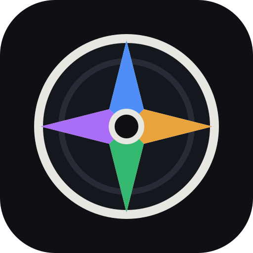
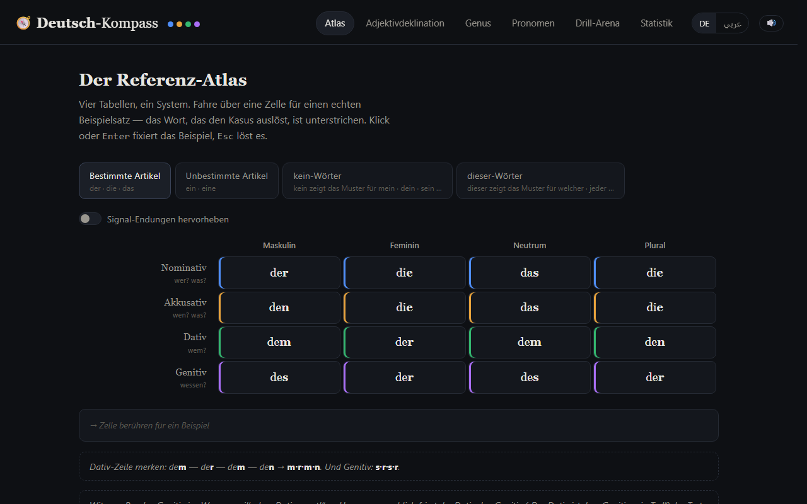

<div align="center">



# 🧭 Deutsch-Kompass

**Interaktiver Offline-Trainer für deutsche Grammatik — mit Erklärungen auf Deutsch und Arabisch**

**مدرّب تفاعلي لقواعد اللغة الألمانية — بشرح ألماني وعربي، يعمل بدون إنترنت**

[](https://deutsch-kompass.vercel.app)
[](https://deutsch-kompass.vercel.app)
[](#-technik)



</div>

---

## ✨ المزايا | Highlights

| | |
|---|---|
| 🌍 **ثنائي اللغة** | كل شرح متوفر بالألمانية **وبالعربية** — مع ربط الحالات الألمانية بمفاهيم الإعراب العربي (الفاعل المرفوع، المفعول المنصوب، المضاف إليه) |
| 📴 **يعمل أوفلاين بالكامل** | تطبيق PWA قابل للتثبيت على الجوال والكمبيوتر — بعد أول زيارة لا يحتاج إنترنت إطلاقًا |
| 🧠 **تكرار ذكي (Leitner)** | المدرّب يتذكر كل خلية في جداول التصريف ويعيد سؤالك عن نقاط ضعفك أكثر من غيرها |
| 🎨 **ألوان ثابتة للحالات** | Nominativ أزرق · Akkusativ كهرماني · Dativ أخضر · Genitiv بنفسجي — في كل صفحات التطبيق (الأحمر محجوز للخطأ فقط) |
| 🔊 **نطق ألماني** | استماع لأي كلمة أو جملة عبر Web Speech API بصوت ألماني |
| ⌨️ **تحكم كامل بلوحة المفاتيح** | أرقام 1–9 للإجابة، Enter للمتابعة، حروف للتنقل — بلا فأرة |
| 🔒 **خصوصية تامة** | لا حسابات، لا تتبّع، لا خوادم — تقدّمك محفوظ في متصفحك فقط مع تصدير/استيراد JSON |

## 📚 الوحدات الست | Die sechs Module

### 1. 🗺️ Referenz-Atlas — أطلس الأدوات
أربعة جداول مترابطة (der/die/das · ein/eine · kein · dieser) مع جملة مثال حقيقية لكل خلية، والكلمة المسبِّبة للحالة مسطّرة. مفتاح **"Signal-Endungen"** يكشف السر: الجداول الأربعة هي جدول واحد بنهايات مميزة (r·e·s·n·m).

### 2. ✍️ Adjektivdeklination — تصريف الصفات
"العوالم الثلاثة" (ضعيف/مختلط/قوي) مشروحة بقاعدة واحدة: *علامة الحالة تظهر مرة واحدة بالضبط*. مختبر تفاعلي تبدّل فيه الأداة والحالة والجنس وترى مَن يحمل العلامة، مع تمييز "بحر الـ -en" (11 خانة من 16 في الجدول الضعيف).

### 3. 🚻 Genus — معرفة der/die/das من شكل الكلمة
أكثر من 40 قاعدة (نهايات وفئات) مرتبة حسب الموثوقية — من القواعد المطلقة (-chen, -lein, -ung 100%) إلى الاتجاهات الغالبة، مع تحذيرات من الأفخاخ الشهيرة (das Mädchen! das Bier!). ويكمّلها **Hinweis-Quiz** من 10 أسئلة تتدرج صعوبتها وتدسّ الأفخاخ.

### 4. 👤 Pronomen — الضمائر وأدوات الملكية
الضمائر الشخصية التسعة (ich→mich→mir … Sie→Sie→Ihnen) وأدوات الملكية الثمانية بكل تصريفاتها، مع مثال مسموع لكل خلية وثلاثة أنماط كويز (شخصية / ملكية / مختلط).

### 5. 🏟️ Drill-Arena — ساحة التدريب
أربعة أنماط:
- **Lückentext** — 90+ جملة حقيقية بفجوات للأدوات ونهايات الصفات
- **Kasus-Detektiv** — حدّد الحالة ثم **علّل** اختيارك (يدرّب الفهم لا الحفظ)
- **Präpositionen** — حروف الجر الثابتة والمتغيرة التسعة (wo? / wohin?)
- **Blitz-Runde ⚡** — 60 ثانية بعداد streak

### 6. 📊 Statistik — خريطة الضعف الحرارية
كل خلية تصريف ملوّنة حسب نسبة أخطائك، مع تحديد "Endgegner" (أصعب خلية عندك)، رسم بياني للدقة عبر الأيام، وتصدير/استيراد التقدم كـ JSON.

## ⌨️ الاختصارات | Tastatur

| Taste | Funktion |
|---|---|
| `1`–`9` | اختيار الإجابة |
| `Enter` | متابعة / بدء |
| `Esc` | الخروج من التمرين / فك تثبيت المثال |
| `A` `J` `G` `P` `D` `S` | Atlas · Adjektiv · Genus · Pronomen · Drill · Statistik |

*اختصارات الحروف تتعطل تلقائيًا أثناء التمارين حتى لا تفقد تقدمك بضغطة خاطئة.*

## 🛠️ التقنية | Technik

- **صفر تبعيات** — Vanilla JavaScript و CSS خالص، بلا أطر عمل، بلا خطوة بناء (≈250 KB كاملًا)
- **PWA** مع Service Worker (cache-first) وتثبيت على الشاشة الرئيسية
- **أمان**: Content-Security-Policy صارم، تحقق كامل من صحة ملفات الاستيراد
- **أصوات** مولّدة بـ Web Audio API (بلا ملفات صوتية) — قابلة للكتم 🔇

## 🚀 التشغيل محليًا | Lokal starten

```sh
git clone https://github.com/Aymn74/deutsch-kompass.git
cd deutsch-kompass
npx serve .        # أو افتح index.html مباشرة — لا يوجد build
```

### الاختبارات | Tests

```sh
npm test
```

تشمل اختبارات رجعية لمنطق الحالة، رفض ملفات الاستيراد التالفة، تنظيف المؤقتات، صحة بنوك المحتوى (120+ كلمة، 90+ جملة)، وتصريف الصفات.

## 📁 بنية المشروع | Struktur

```
index.html            هيكل التطبيق + CSP
data.js               كل المحتوى اللغوي (جداول، جمل، قواعد Genus، نصائح ثنائية اللغة)
state.js              التقدم + localStorage + خوارزمية Leitner
atlas.js / adjektiv.js / genus.js / pronomen.js / drill.js / stats.js
app.js                التوجيه + اللغة + لوحة المفاتيح
service-worker.js     العمل أوفلاين
tests/                اختبارات رجعية (Node، بلا تبعيات)
```

---

<div align="center">

**جرّبه الآن → [deutsch-kompass.vercel.app](https://deutsch-kompass.vercel.app)**

صُنع لمتعلمي الألمانية الناطقين بالعربية 🇩🇪🤝🇸🇦

</div>
